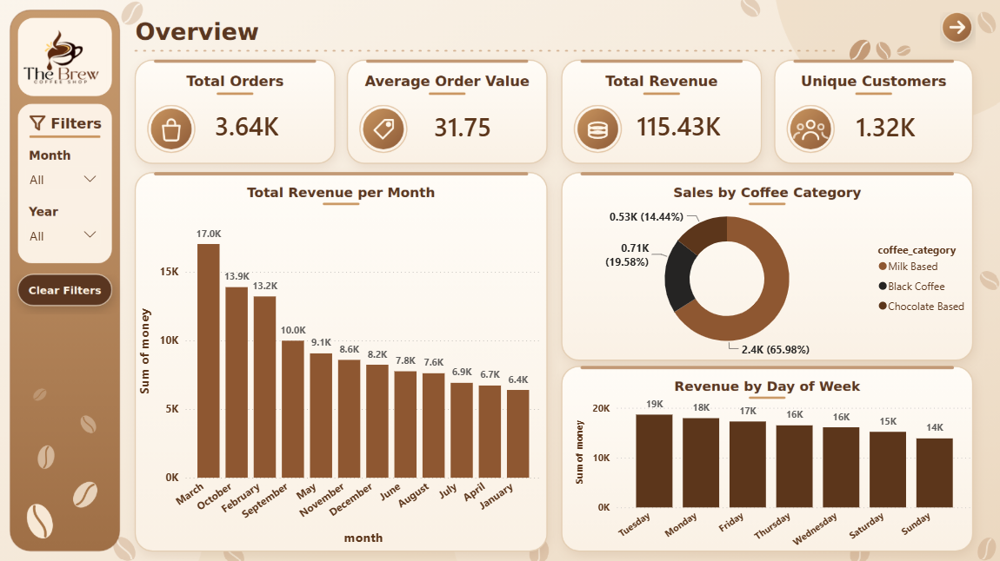

# The Brew Coffee Shop | Power BI Dashboard

A Power BI dashboard analyzing coffee shop sales, product performance, and customer behavior.

## 🏆 Achievement

**3rd Place — Hackathon**

Recognized for best results and visual design.

## 🎥 Demo Video

[Watch Dashboard Demo](https://drive.google.com/file/d/1itIQVRzX1V0LPycE8ZDulolYgmoa2uMZ/view?usp=sharing)

## Dashboard Preview

### 1. Overview

Sales KPIs, monthly revenue, coffee categories, and daily sales.

### 2. Product Insights

Product performance and sales analysis.

### 3. Customer Loyalty

Customer behavior, loyalty, and payment preferences.

## Key Features

- Sales and revenue analysis.
- Product performance insights.
- Customer behavior analysis.
- Interactive month and year filters.
- KPI cards and visualizations.

## Tools

- Microsoft Power BI
- Data Analytics
- Business Intelligence

## Repository Contents

- `Hackathon نيوتك.pbix` — Power BI report.
- `overview.png` — Overview page.
- `Product Insights.png` — Product analysis.
- `Customer Loyalty.png` — Customer analysis.

## How to Explore

Download the `.pbix` file and open it in Power BI Desktop to explore the dashboard.

**Note:** Data refresh may depend on the original data sources and configuration.
